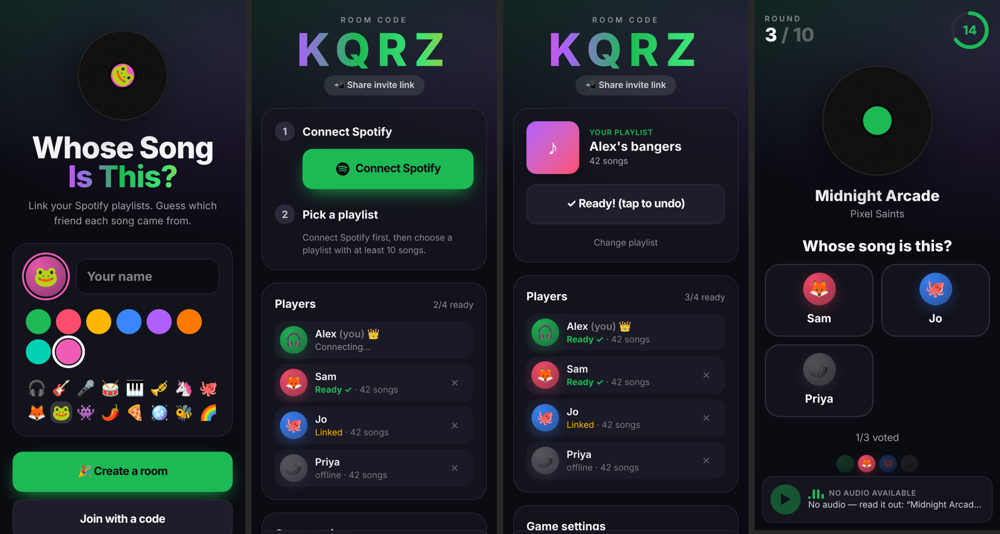
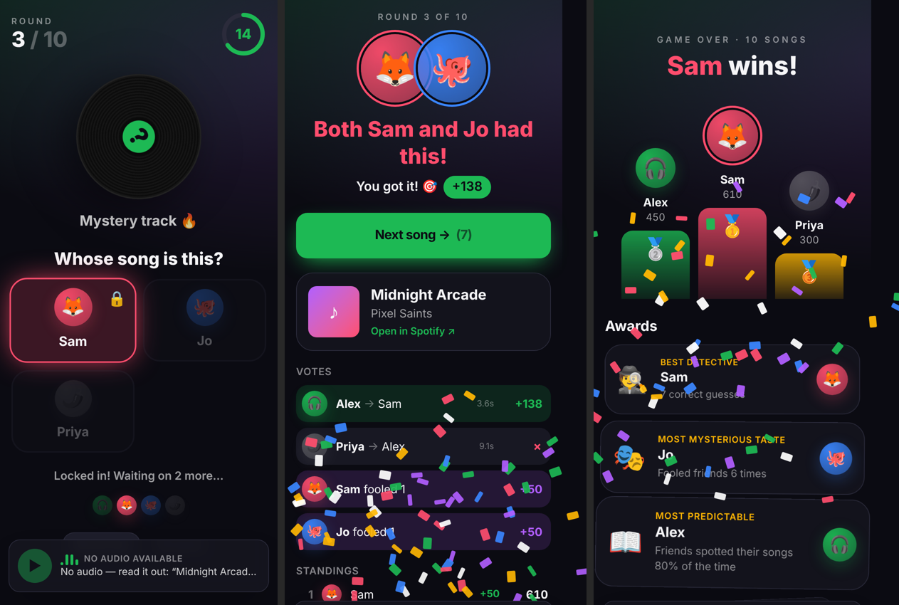

# 🎵 Whose Song Is This?

A multiplayer party game for phones. Friends connect Spotify, each links a
playlist, and every round a random song plays. Everyone guesses which
friend's playlist it came from.

- **Frontend:** React 19 + Tailwind CSS 4 (Vite), mobile-first, dark theme
- **Backend:** Node.js + Express + Socket.IO, all game state server-side
- **Spotify:** Authorization Code + PKCE handled on the server. Tokens never
  reach the browser, and no client secret is used.

```
whose-song/
├── server/
│   ├── src/game.js       ← pure game engine (rules, scoring, awards)
│   ├── src/rooms.js      ← room registry, timers, broadcasting
│   ├── src/socket.js     ← Socket.IO event handlers
│   ├── src/spotify.js    ← OAuth PKCE + Web API client
│   ├── src/sessions.js   ← in-memory sessions (holds Spotify tokens)
│   ├── src/demo.js       ← fake playlists for testing
│   ├── src/index.js      ← HTTP routes + static hosting
│   └── test/             ← engine unit tests (node:test)
├── client/
│   └── src/
│       ├── audio/        ← playback abstraction: SDK → preview → embed → title
│       ├── screens/      ← Home, Lobby, Round, Reveal, End
│       └── components/
└── docs/SPOTIFY_SETUP.md ← registering the Spotify app (read this!)
```




## Quick start

Requires **Node 20.19+**.

```bash
npm install
cp .env.example .env          # add SPOTIFY_CLIENT_ID (see docs/SPOTIFY_SETUP.md)
npm run dev                   # server :3001 + client :5173
```

Open **http://127.0.0.1:5173**. Use `127.0.0.1`, not `localhost`: Spotify
rejects `localhost` redirect URIs.

**Try it without Spotify:** set `ENABLE_DEMO_PLAYLISTS=true` in `.env`, then
open the game in a normal window plus a couple of private windows. Each gets
its own session, so you can play against yourself with fake playlists.

```bash
npm test                      # game engine tests
```

## Playing on phones

Phones can't reach `127.0.0.1` on your laptop, and Spotify only allows `https`
redirect URIs for non-loopback hosts. The easiest setup is a production build
behind an HTTPS tunnel:

```bash
npm run build                                   # builds client into client/dist
cloudflared tunnel --url http://127.0.0.1:3001  # or: ngrok http 3001
```

Then set these in `.env` (using the tunnel's URL) and run `npm start`:

```
PUBLIC_URL=https://random-words.trycloudflare.com
SPOTIFY_REDIRECT_URI=https://random-words.trycloudflare.com/auth/callback
```

Also add that redirect URI in the Spotify dashboard. The Node server serves
the built client, the API, and WebSockets from one origin.

**Deploying** (Render, Fly.io, Railway, a VPS) works the same way: build
command `npm install && npm run build`, start command `npm start`, set
`HOST=0.0.0.0`, `PORT`, `PUBLIC_URL`, and `SPOTIFY_CLIENT_ID`. Run a **single
instance**, because rooms and sessions live in memory.

## How to play

1. **Host** taps *Create a room* and shares the 4-letter code or invite link.
2. Everyone joins with a name, color, and avatar, taps **Connect Spotify**,
   picks a playlist (10+ songs, or paste a playlist link), and taps **Ready**.
3. Host picks **5 / 10 / 15 / ∞ rounds**, optionally **Hard mode** (art and
   title hidden), and taps **Start**.
4. Each round, a song plays on the host's phone and everyone has **20
   seconds** to vote. You can't vote for yourself.
5. The reveal shows the owner(s), who guessed right, and points.

**Scoring**
- **+100** for a correct guess
- **+0–50** speed bonus (linear over the 20 seconds)
- **+50** to the song's owner for every player they fooled. Owners bluffing on
  their own song don't count as "fooled".

**Awards:** 🕵️ Best Detective, 🎭 Most Mysterious Taste, 📖 Most Predictable,
⚡ Fastest Finger.

## Edge cases

| Case | Behavior |
|---|---|
| Shared songs | Matched by ISRC, falling back to track ID. Any owner counts as correct, and the reveal says "Both Alex and Sam had this!" Every owner gets the fool bonus. |
| No repeats | A song key is never played twice in one game. The game ends early if the pool runs out. |
| Playlist weighting | Picks a random **owner** first, then a random song of theirs, so a 500-song playlist doesn't drown out a 10-song one. |
| No preview URL | Falls back to the embed player, then to showing title and artist. The host can also enable "Only songs with previews" when previews exist. |
| Small playlists | Rejected below 10 playable tracks. Local files, podcasts, and duplicates are excluded. |
| Disconnects | Your session lives in `localStorage`. Reloading or reconnecting puts you back in the room mid-game. Offline players are skipped, and a round closes early once every connected player has voted. If the host is gone for 20s, the next player becomes host. |
| Late joiners | Can join mid-game, vote right away, and link a playlist to add songs to the pool. |
| Leaving mid-game | Your songs leave the pool, but your score stays on the board. |

## Socket events

Client → server (all take an ack callback `{ ok, error? }`):
`room:create`, `room:join`, `room:resume`, `room:leave`, `player:update`,
`player:ready`, `playlist:list`, `playlist:link`, `playlist:unlink`, `vote`,
`host:settings`, `host:start`, `host:next`, `host:end`, `host:playAgain`,
`host:kick`

Server → client: `state` (full room snapshot, personalized per player),
`kicked`, `left`

The `state` snapshot sends playback info (`round.playback`) only to devices
that play audio. In hard mode, the track's title and art reach other players
only at the reveal.

## Security notes

- Spotify access and refresh tokens are kept in server memory, keyed by an
  opaque session token. The client secret is never used.
- The one exception is opt-in: with `ENABLE_WEB_PLAYBACK_SDK=true`,
  `/api/playback/token` gives a user's own short-lived access token to their
  own browser, because the Web Playback SDK requires one.
- OAuth `state` is single-use and expires after 10 minutes. `returnTo` only
  accepts same-site paths.
- Sessions and rooms are in memory, so restarting the server ends all games.
  Swap `sessions.js` and `rooms.js` for Redis if you need persistence or
  multiple instances.
